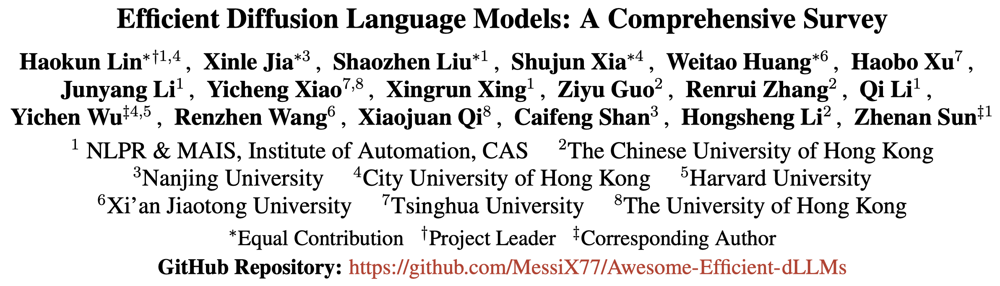
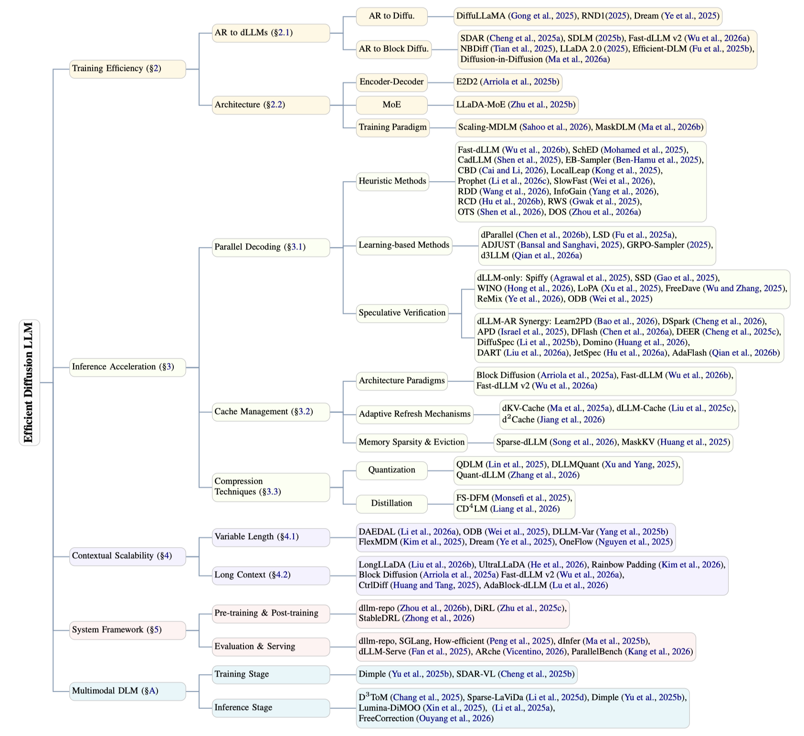

# Awesome-Efficient-dLLMs

[](https://github.com/MessiX77/Awesome-Efficient-dLLMs)
[](https://img.shields.io/github/stars/MessiX77/Awesome-Efficient-dLLMs.svg?style=social)
[](https://creativecommons.org/licenses/by-nc-nd/4.0/)
[](https://img.shields.io/badge/PRs-Welcome-red)
[](https://github.com/MessiX77/Awesome-Efficient-dLLMs/blob/main/files/Efficient_dLLMs_EMNLP2026.pdf)
[](https://github.com/MessiX77/Awesome-Efficient-dLLMs/blob/main/files/Efficient_dLLMs_EMNLP2026.pdf)
[](https://www.authorea.com/users/1021451/articles/1381451-efficient-diffusion-language-models-a-comprehensive-survey)


📒A curated list of Awesome **Efficient Diffusion Language Models** Papers with codes.

<p align="center">
    
</p>


<p align="center">
    
</p>


## 📖 News 🔥🔥
<div id="news"></div>

- [2026-10-25]: 🤗 Added **115** dLLM efficiency-related papers from **EMNLP 2026** (Main, Findings, and Industry) and **NeurIPS 2026**.

- [2026-09-01]: 🤗 We update the **ICML 2026** and **ACL 2026** accepted papers!

- [2026-09-01]: 🚀 Our [second version paper](./files/Efficient_dLLMs_EMNLP2026.pdf) (**EMNLP 2026 Findings**) is available!

- [2026-08-21]: 🎉 Our survey has been accepted to **EMNLP 2026 Findings**!

- [2026-04-24]: 🚀 We have migrated this repository to [MessiX77](https://github.com/MessiX77/Awesome-Efficient-dLLMs). Please star and follow the new repo!

- [2026-02-02]: 🤗 We update the ICLR 2026 accepted papers!

- [2026-01-26]: 🤗 Our [first version paper](https://doi.org/10.22541/au.176918713.36402137/v1) is available!

- [2026-01-23]: 🤗 We release the repository!


## 🤖Contents

- [Awesome-Efficient-dLLMs](#awesome-efficient-dllms)
  - [🤖Contents](#contents)
  - [📙 Training Efficiency](#-training-efficiency)
  - [📙 Inference Acceleration | Parallel Decoding](#-inference-acceleration--parallel-decoding)
  - [📙 Inference Acceleration | Cache Management](#-inference-acceleration--cache-management)
  - [📙 Inference Acceleration | Compression Techniques](#-inference-acceleration--compression-techniques)
  - [📙 Contextual Scalability | Variable Length](#-contextual-scalability--variable-length)
  - [📙 Contextual Scalability | Long Context](#-contextual-scalability--long-context)
  - [📙 System Framework](#-system-framework)
  - [📙 Multimodal DLM](#-multimodal-dlm)
  - [©️Citations](#️citations)


## 📙 Training Efficiency  

<div id="Training"></div>  

|Date|Category|Title|Paper|Code|Venue|
|:---:|:---|:---|:---:|:---:|:---:| 
|2024.10| AR-to-diffusion |[**DiffuLLaMA**] Scaling Diffusion Language Models via Adaptation from Autoregressive Models (@HKU)  | [[pdf]](https://arxiv.org/pdf/2410.17891) |[[code]](https://github.com/HKUNLP/DiffuLLaMA)  |ICLR 2025|
|2025.07| AR-to-diffusion |[**Dream 7B**] Dream 7B: Diffusion Large Language Models (@HKU)  | [[pdf]](https://arxiv.org/pdf/2508.15487) |[[code]](https://github.com/DreamLM/Dream)  |arXiv|
|2025.10| AR-to-diffusion |[**RND1**] RND1: Simple, Scalable AR-to-Diffusion Conversion (@Radical Numerics)  | [[pdf]](https://www.radicalnumerics.ai/assets/rnd1_report.pdf) |[[code]](https://github.com/RadicalNumerics/RND1)  |blog|
|2026.10| AR-to-diffusion |[**FLARE**] FLARE: Diffusion for Hybrid Language Model (@Adobe)| [[paper]](https://neurips.cc/virtual/2026/poster/150224) | [[code]](https://github.com/yuchen-zhu-zyc/HybridDiffusion)  |NeurIPS 2026|
|2025.09| AR-to-block diffusion |[**SDLM**] Sequential Diffusion Language Models (@Shanghai AI Lab)  | [[paper]](https://aclanthology.org/2026.emnlp-main.2288/) |[[code]](https://github.com/OpenGVLab/SDLM)  |EMNLP 2026|
|2025.09| AR-to-block diffusion |[**Fast-dLLM v2**] Fast-dLLM v2: Efficient Block-Diffusion LLM (@NVIDIA)  | [[pdf]](https://arxiv.org/pdf/2509.26328) |[[code]](https://github.com/NVlabs/Fast-dLLM)  |ICLR 2026|
|2025.10| AR-to-block diffusion |[**SDAR**] SDAR: A Synergistic Diffusion-AutoRegression Paradigm for Scalable Sequence Generation (@Shanghai AI Lab)  | [[pdf]](https://arxiv.org/pdf/2510.06303) |[[code]](https://github.com/JetAstra/SDAR)  |ACL 2026 Findings|
|2025.12| AR-to-block diffusion |[**LLaDA2.0**] LLaDA2.0: Scaling Up Diffusion Language Models to 100B (@Ant Group)  | [[pdf]](https://arxiv.org/pdf/2512.15745) | [[code]](https://github.com/inclusionAI/LLaDA2.0)  |arXiv|
|2025.12| AR-to-block diffusion |[**Efficient-DLM**] Efficient-DLM: From Autoregressive to Diffusion Language Models, and Beyond in Speed (@NVIDIA)  | [[pdf]](https://arxiv.org/pdf/2512.14067) |  |ICML 2026|
|2025.12| AR-to-block diffusion |[**NBDiff**] From Next-Token to Next-Block: A Principled Adaptation Path for Diffusion LLMs (@Shanghai AI Lab)  | [[paper]](https://neurips.cc/virtual/2026/poster/152123) |[[code]](https://github.com/prajwal369/NBDiff)  |NeurIPS 2026|
|2026.01| AR-to-block diffusion |[**Diffusion In Diffusion**] Diffusion In Diffusion: Reclaiming Global Coherence in Semi-Autoregressive Diffusion (@Huawei)  | [[pdf]](https://arxiv.org/pdf/2601.13599) | |arXiv|
|2026.10| AR-to-block diffusion |[**MBD-LMs**] Multi-Block Diffusion Language Models (@SJTU)| [[paper]](https://aclanthology.org/2026.emnlp-main.1971/) |[[code]](https://github.com/SJTU-DENG-Lab/mbd-lms)  |EMNLP 2026|
|2025.09| MoE |[**LLaDA-MoE**] LLaDA-MoE: A Sparse MoE Diffusion Language Model (@Ant Group)  | [[pdf]](https://arxiv.org/pdf/2509.24389) |  |arXiv|
|2026.05| MoE |[**dMoE**] dMoE: dLLMs with Learnable Block Experts (@NUS)  | [[paper]](https://neurips.cc/virtual/2026/poster/153054) |[[code]](https://github.com/fscdc/dMoE)  |NeurIPS 2026|
|2025.12| Encoder-Decoder |[**E2D2**] Encoder-Decoder Diffusion Language Models for Efficient Training and Inference (@Cornell)  | [[pdf]](https://arxiv.org/pdf/2510.22852) | [[code]](https://github.com/kuleshov-group/e2d2)  |NeurIPS 2025|
|2026.02| Scaling Law |[**Scaling Beyond MDLM**] Scaling Beyond Masked Diffusion Language Models (@NVIDIA)| [[pdf]](https://arxiv.org/pdf/2602.15014) |[[code]](https://github.com/s-sahoo/scaling-dllms) |ICML 2026|
|2026.10| Scaling Law |[**Quokka**] Training Optimal Large Diffusion Language Models (@NUS)| [[paper]](https://neurips.cc/virtual/2026/poster/152102) | [[code]](https://github.com/JinjieNi/Quokka)  |NeurIPS 2026|
|2026.10| Scaling Law |[**RePlaid**] Continuous Diffusion Scales Competitively with Discrete Diffusion for Language (@NVIDIA)| [[paper]](https://neurips.cc/virtual/2026/poster/152067) | |NeurIPS 2026|
|2026.03| Training Paradigm |[**Mask Is What DLLM Needs**] Mask Is What DLLM Needs: A Masked Data Training Paradigm for Diffusion LLMs (@Huawei)| [[pdf]](https://arxiv.org/pdf/2603.15803) | |arXiv|
|2026.07| Architecture |[**WeDLM**] WeDLM: Reconciling Diffusion Language Models with Standard Causal Attention for Fast Inference| [[paper]](https://icml.cc/virtual/2026/poster/64095) |[[code]](https://github.com/Tencent/WeDLM) |ICML 2026|
|2026.07| Architecture |[**Any-Order GPT**] Any-Order GPT as Masked Diffusion Model: Decoupling Formulation and Architecture| [[paper]](https://icml.cc/virtual/2026/poster/61245) |[[code]](https://github.com/scxue/AO-GPT-MDM) |ICML 2026|
|2026.07| Architecture |[**Esoteric LMs**] Esoteric Language Models: A Family of Any-Order Diffusion LLMs| [[paper]](https://icml.cc/virtual/2026/poster/66382) |[[code]](https://github.com/s-sahoo/Eso-LMs) |ICML 2026|
|2026.07| Architecture |[**DiffuMamba**] DiffuMamba: High-Throughput Diffusion LMs with Mamba Backbone| [[paper]](https://icml.cc/virtual/2026/poster/62355) | |ICML 2026|
|2026.10| Architecture |[**Evo**] Evo: Autoregressive–Diffusion Large Language Models with Evolving Balance (@Oxford)| [[paper]](https://aclanthology.org/2026.emnlp-main.134/) | |EMNLP 2026|
|2026.10| Architecture |[**Nemotron-Labs-Diffusion**] Nemotron-Labs-Diffusion: A Tri-Mode Language Model Unifying Autoregressive, Diffusion, and Self-Speculation Decoding (@NVIDIA)| [[paper]](https://aclanthology.org/2026.emnlp-main.2416/) | [[code]](https://github.com/NVlabs/Nemotron-Labs-Diffusion)  |EMNLP 2026|
|2026.10| Architecture |[**RMDM**] Representation-based Masked Diffusion Model (@PolyUHK)| [[paper]](https://aclanthology.org/2026.findings-emnlp.302/) | |EMNLP 2026 Findings|
|2026.10| Architecture |[**B3D-RWKV**] Triplet-Block Diffusion RWKV (@CityU)| [[paper]](https://aclanthology.org/2026.findings-emnlp.940/) |[[code]](https://github.com/leonardodalinky/B3D-RWKV)  |EMNLP 2026 Findings|
|2026.10| Architecture |[**LoopMDM**] Looped Diffusion Language Models (@KAIST)| [[paper]](https://neurips.cc/virtual/2026/poster/152196) | |NeurIPS 2026|
|2026.10| Architecture |[**LDLM**] How to Train Your Latent Diffusion Language Model Jointly With the Latent Space (@Constructor Univ.)| [[paper]](https://neurips.cc/virtual/2026/poster/155226) | |NeurIPS 2026|
|2026.10| Architecture |[**TTCD**] Token Time Continuous Diffusion for Language Modeling (@UT-Austin)| [[paper]](https://neurips.cc/virtual/2026/poster/153937) | |NeurIPS 2026|
|2026.10| Architecture |[**Entropy-Gated Bitstream Diffusion**] Towards Closing the Autoregressive Gap in Language Modeling via Entropy-Gated Continuous Bitstream Diffusion (@Cambridge)| [[paper]](https://neurips.cc/virtual/2026/poster/151917) | [[code]](https://github.com/GBATZOLIS/BitstreamDiffusion)  |NeurIPS 2026|
|2026.07| MoE |[**TEAM**] TEAM: Temporal-Spatial Consistency Guided Expert Activation for MoE Diffusion Language Model Acceleration| [[paper]](https://icml.cc/virtual/2026/poster/63641) |[[code]](https://github.com/PKU-SEC-Lab/TEAM-MoE-dLLM) |ICML 2026|
|2026.10| MoE |[**ReDLLM**] Rethinking Diffusion Large Language Models via Time-aware Weighting and Block-oriented Refinements (@Xiaohongshu)| [[paper]](https://aclanthology.org/2026.emnlp-main.1836/) | |EMNLP 2026|
|2026.10| MoE |[**Dynamic Expert Sharing**] Dynamic Expert Sharing: Decoupling Memory from Parallelism in Mixture-of-Experts Diffusion LLMs (@ICL)| [[paper]](https://neurips.cc/virtual/2026/poster/155427) | |NeurIPS 2026|
|2026.07| Training Paradigm |[**Progressive Unmasking**] Stop Training for the Worst: Progressive Unmasking Accelerates Masked Diffusion Training| [[paper]](https://icml.cc/virtual/2026/poster/66284) |[[code]](https://github.com/JaeyeonKim01/PUMA) |ICML 2026|
|2026.07| Training Paradigm |[**InfoDLM**] InfoDLM: An Information-Adaptive Framework for Discrete Diffusion Language Model Pretraining| [[paper]](https://icml.cc/virtual/2026/poster/62899) | |ICML 2026|
|2026.07| Training Paradigm |[**Factorization Barrier**] Breaking the Factorization Barrier in Diffusion Language Models| [[paper]](https://icml.cc/virtual/2026/poster/62624) |[[code]](https://github.com/liuanji/CoDD) |ICML 2026|
|2026.07| Training Paradigm |[**Set Diffusion**] Set Diffusion: Interpolating Token Orderings between Autoregression and Diffusion for Fast and Flexible Decoding| [[paper]](https://icml.cc/virtual/2026/poster/61135) | |ICML 2026|
|2026.10| Training Paradigm |[**MDM-Prime-v2**] MDM-Prime-v2: Binary Encoding and Index Shuffling Enable Scaling of Diffusion Language Models (@UofT)| [[paper]](https://aclanthology.org/2026.emnlp-main.556/) | [[code]](https://github.com/chen-hao-chao/mdm-prime-v2)  |EMNLP 2026|
|2026.10| Training Paradigm |[**DreamReasoner-8B**] DreamReasoner-8B: Block-Size Curriculum Learning for Diffusion Reasoning Models (@HKU)| [[paper]](https://aclanthology.org/2026.emnlp-main.1508/) |[[code]](https://github.com/DreamLM/DreamReasoner)  |EMNLP 2026|
|2026.10| Training Paradigm |[**LUDI**] Less Uniform Discrete Diffusion is More Powerful and Scalable (@HKUST)| [[paper]](https://aclanthology.org/2026.emnlp-main.1714/) | |EMNLP 2026|
|2026.10| Training Paradigm |[**MMT**] Fast Block Diffusion Training via Multi-Mask Context Sharing (@THU)| [[paper]](https://aclanthology.org/2026.emnlp-main.2034/) | |EMNLP 2026|
|2026.10| Training Paradigm |[**DSL-LLaDA**] DSL-LLaDA: Scaling Continuous Denoising to 8B Masked Diffusion LMs (@UCR)| [[paper]](https://aclanthology.org/2026.findings-emnlp.2101/) | |EMNLP 2026 Findings|
|2026.10| Training Paradigm |[**MemDLM**] MemDLM: Memory-Enhanced DLM Training (@CUHK)| [[paper]](https://neurips.cc/virtual/2026/poster/153503) | [[code]](https://github.com/JarvisPei/MemDLM)  |NeurIPS 2026|
|2026.10| Training Paradigm |[**LOOT**] Empowering Masked Diffusion Models to Self-Correct with Leave-One-Out Transformers| [[paper]](https://neurips.cc/virtual/2026/poster/150367) | |NeurIPS 2026|
|2026.10| Training Paradigm |[**SemDLM+**] SemanticDLM+: Improving Diffusion LLMs through Bias-variance Trade-off in Transition Kernel Design (@Alibaba)| [[paper]](https://neurips.cc/virtual/2026/poster/149281) | |NeurIPS 2026|


## 📙 Inference Acceleration | Parallel Decoding
<div id="Parallel"></div> 

<p align="center">
    
</p>
 
|Date|Category|Title|Paper|Code|Venue|
|:---:|:---|:---|:---:|:---:|:---:|  
|2025.05| Heuristic Methods |[**Fast-dLLM**] Fast-dLLM: Training-free Acceleration of Diffusion LLM by Enabling KV Cache and Parallel Decoding (@NVIDIA)| [[pdf]](https://arxiv.org/pdf/2505.22618) |[[code]](https://github.com/NVlabs/Fast-dLLM) |ICLR 2026|
|2025.05| Heuristic Methods |[**EB-Sampler**] Accelerated Sampling from Masked Diffusion Models via Entropy Bounded Unmasking (@Meta)| [[pdf]](https://arxiv.org/pdf/2505.24857) | |NeurIPS 2025|
|2025.06| Heuristic Methods |[**SlowFast Sampling**] Accelerating diffusion large language models with slowfast: The three golden principles (@SJTU)| [[pdf]](https://arxiv.org/pdf/2506.10848) | [[code]](https://github.com/LiangrunFlora/Slow-Fast-Sampling) |ICLR 2026|
|2025.08| Heuristic Methods |[**Prophet**] Diffusion language models know the answer before decoding (@PolyUHK)| [[pdf]](https://arxiv.org/pdf/2508.19982) | [[code]](https://github.com/pixeli99/Prophet) |ICLR 2026|
|2025.08| Heuristic Methods |[**RWS**] Reward-Weighted Sampling: Enhancing Non-Autoregressive Characteristics in Masked Diffusion LLMs (@KAIST)| [[pdf]](https://arxiv.org/pdf/2509.00707) | |EMNLP 2025|
|2025.10| Heuristic Methods |[**LocalLeap**] Accelerated Diffusion LLM Inference via Local Determinism Propagation (@Kuaishou)| [[pdf]](https://arxiv.org/pdf/2510.07081) | [[code]](https://github.com/friedrichor/LocalLeap) |arXiv|
|2025.10| Heuristic Methods |[**Saber**] Saber: An Efficient Sampling with Adaptive Acceleration and Backtracking Enhanced Remasking for Diffusion Language Model (@PKU)| [[pdf]](https://arxiv.org/pdf/2510.18165) |[[code]](https://github.com/zhaoyMa/Saber) |ACL 2026|
|2025.12| Heuristic Methods |[**SchED**] Fast-Decoding Diffusion Language Models via Progress-Aware Confidence Schedules (@MBZUAI)| [[pdf]](https://arxiv.org/pdf/2512.02892) |[[code]](https://github.com/amr-mohamedd/SchED) |ACL 2026 Findings|
|2025.12| Heuristic Methods |[**CadLLM**] Improving the Throughput of Diffusion-based Large Language Models via a Training-Free Confidence-Aware Calibration (@Intel)| [[pdf]](https://arxiv.org/pdf/2512.07173) |[[code]](https://github.com/juchengshen/CadLLM) |ACL 2026 Findings|
|2026.01| Heuristic Methods |[**Diffusion In Diffusion**] Diffusion In Diffusion: Reclaiming Global Coherence in Semi-Autoregressive Diffusion (@Huawei)  | [[pdf]](https://arxiv.org/pdf/2601.13599) | |arXiv|
|2026.01| Heuristic Methods |[**RCD**] Residual Context Diffusion Language Models (@UC Berkeley)| [[pdf]](https://arxiv.org/pdf/2601.22954) | |ICML 2026|
|2026.01| Heuristic Methods |[**Order-Token Search**] Improving Diffusion Language Model Decoding through Joint Search in Generation Order and Token Space (@Stanford)| [[paper]](https://aclanthology.org/2026.emnlp-main.24/) | |EMNLP 2026|
|2026.01| Heuristic Methods |[**RDD**] Reversible Diffusion Decoding for Diffusion Language Models (@ZJU)| [[pdf]](https://arxiv.org/pdf/2602.00150) | |arXiv|
|2026.02| Heuristic Methods |[**dVoting**] dVoting: Fast Voting for dLLMs (@NUS)| [[pdf]](https://arxiv.org/pdf/2602.12153) |[[code]](https://github.com/fscdc/dVoting) |arXiv|
|2026.02| Heuristic Methods |[**Info-Gain Sampler**] Improving Sampling for Masked Diffusion Models via Information Gain (@CMU)| [[pdf]](https://arxiv.org/pdf/2602.18176) |[[code]](https://github.com/yks23/Information-Gain-Sampler) |ICML 2026|
|2026.03| Heuristic Methods |[**DOS**] DOS: Dependency-Oriented Sampler for Masked Diffusion Language Models (@SEU)| [[pdf]](https://arxiv.org/pdf/2603.15340) | |ACL 2026 Findings|
|2026.03| Heuristic Methods |[**Confidence-Based Decoding**] Confidence-Based Decoding is Provably Efficient for Diffusion Language Models (@UMD)| [[paper]](https://neurips.cc/virtual/2026/poster/151802) | |NeurIPS 2026|
|2026.06| Heuristic Methods |[**Fast-dLLM++**] Fast-dLLM++: Fréchet Profile Decoding for Faster Diffusion LLM Inference| [[paper]](https://neurips.cc/virtual/2026/poster/154725) |[[code]](https://github.com/Ringo-Star/FastdLLM_plusplus) |NeurIPS 2026|
|2026.07| Heuristic Methods |[**CreditDecoding**] CreditDecoding: Accelerating Parallel Decoding in Diffusion Large Language Models with Trace Credit| [[pdf]](https://arxiv.org/pdf/2510.06133) | |ACL 2026|
|2026.07| Heuristic Methods |[**DecoCal**] DecoCal: Decoding with Calibration in Diffusion Large Language Models| [[paper]](https://aclanthology.org/2026.acl-long.545/) |[[code]](https://github.com/pku0xff/DecoCal) |ACL 2026|
|2026.07| Heuristic Methods |[**AHD**] Breaking Block Boundaries: Anchor-based History-stable Decoding for Diffusion Large Language Models| [[pdf]](https://arxiv.org/pdf/2604.08964) |[[code]](https://github.com/zs1314/AHD) |ACL 2026|
|2026.07| Heuristic Methods |[**Ada-DLM**] Towards Efficient and Effective Diffusion Language Model Inference via Semantic-Aware Adaptive Denoising| [[paper]](https://aclanthology.org/2026.acl-long.819/) | |ACL 2026|
|2026.07| Heuristic Methods |[**FOCUS**] FOCUS: DLLMs Know How to Tame Their Compute Bound| [[paper]](https://icml.cc/virtual/2026/poster/66409) |[[code]](https://github.com/sands-lab/FOCUS) |ICML 2026|
|2026.07| Heuristic Methods |[**LUGS**] LUGS: Latent-aware Guidance for Efficient Unmasking in Diffusion Large Language Models| [[paper]](https://icml.cc/virtual/2026/poster/61065) | |ICML 2026|
|2026.07| Heuristic Methods |[**Lookahead Unmasking**] Lookahead Unmasking Elicits Reliable Decoding in Diffusion Language Models| [[paper]](https://icml.cc/virtual/2026/poster/64337) | |ICML 2026|
|2026.07| Heuristic Methods |[**Swordsman**] Swordsman: Entropy-Driven Adaptive Block Partition for Efficient Diffusion Language Models| [[paper]](https://icml.cc/virtual/2026/poster/65444) | |ICML 2026|
|2026.07| Heuristic Methods |[**Bits to Rounds**] From Bits to Rounds: Parallel Decoding with Exploration for Diffusion Language Models| [[paper]](https://icml.cc/virtual/2026/poster/65555) | |ICML 2026|
|2026.07| Heuristic Methods |[**Adaptive Order**] Demystifying MaskGIT Sampler and Beyond: Adaptive Order Selection in Masked Diffusion| [[paper]](https://icml.cc/virtual/2026/poster/68828) | |ICML 2026|
|2026.07| Heuristic Methods |[**CORE**] CORE: Context-Robust Remasking for Diffusion Language Models| [[paper]](https://icml.cc/virtual/2026/poster/62928) |[[code]](https://github.com/UCF-CRCV/core) |ICML 2026|
|2026.07| Heuristic Methods |[**DC-Leap**] DC-Leap: Training-Free Acceleration of dLLMs via Draft-Guided Contiguous Leaping Decoding| [[paper]](https://icml.cc/virtual/2026/poster/63573) |[[code]](https://github.com/ffh-wyls/DC-Leap) |ICML 2026|
|2026.07| Heuristic Methods |[**Beyond Confidence**] Beyond Confidence: Adaptive and Coherent Decoding for Diffusion Language Models| [[paper]](https://icml.cc/virtual/2026/poster/63007) | |ICML 2026|
|2026.07| Heuristic Methods |[**Plan for Speed**] Plan for Speed: Dilated Scheduling for Masked Diffusion Language Models| [[paper]](https://icml.cc/virtual/2026/poster/65445) |[[code]](https://github.com/omerlux/DUS) |ICML 2026|
|2026.07| Heuristic Methods |[**PoE-Bridge**] Diffusion Language Model Parallel Decoding via Product-of-Experts Bridge| [[paper]](https://icml.cc/virtual/2026/poster/62267) |[[code]](https://github.com/juntongshi48/poe-bridge) |ICML 2026|
|2026.10| Heuristic Methods |[**FDM**] Decoding Diffusion Language Models with Foreseeing Movement (@PKU)| [[paper]](https://aclanthology.org/2026.emnlp-main.909/) | [[repo]](https://github.com/PKU-ML/FDM) *(no implementation yet)* |EMNLP 2026|
|2026.10| Heuristic Methods |[**DiffuTester**] DiffuTester: Accelerating Unit Test Generation for Diffusion LLMs via Mining Structural Pattern (@THU)| [[paper]](https://aclanthology.org/2026.emnlp-main.1046/) |[[code]](https://github.com/THU-Agent/DiffuTester)  |EMNLP 2026|
|2026.10| Heuristic Methods |[**ASRD**] Follow the Latent Roadmap: Navigating Revocable Decoding for Diffusion LLMs with Anchor Tokens (@KCL)| [[paper]](https://aclanthology.org/2026.emnlp-main.1256/) | [[code]](https://github.com/preordinary/ASRD)  |EMNLP 2026|
|2026.10| Heuristic Methods |[**FUSA**] Signals from the Future: Future-aware Semi-Autoregressive Decoding for Diffusion Language Models (@UNIST)| [[paper]](https://aclanthology.org/2026.emnlp-main.2327/) |[[code]](https://github.com/yangryeol/FUSA)  |EMNLP 2026|
|2026.10| Heuristic Methods |[**CLAD**] Cluster-Level Attention-Guided Parallel Decoding for Masked Diffusion Language Models (@ZJU)| [[paper]](https://aclanthology.org/2026.findings-emnlp.275/) | [[code]](https://github.com/ziyigu2004/CLAD)  |EMNLP 2026 Findings|
|2026.10| Heuristic Methods |[**CoDR**] CoDR: Training-Free Confidence-Drift Remasking for Diffusion Language Models (@PolyUHK)| [[paper]](https://aclanthology.org/2026.findings-emnlp.1230/) | [[code]](https://github.com/YueWu0301/CoDR)  |EMNLP 2026 Findings|
|2026.10| Heuristic Methods |[**BlockBatch**] BlockBatch: Multi-Scale Consensus Decoding for Efficient Diffusion Language Model Inference (@Georgia Tech)| [[paper]](https://aclanthology.org/2026.findings-emnlp.1492/) | [[code]](https://github.com/Laurence-Wu/BlockBatch)  |EMNLP 2026 Findings|
|2026.10| Heuristic Methods |[**TDAR**] Adaptive Test-Time Compute Allocation for Block Diffusion Language Models in Complex Reasoning (@FDU)| [[paper]](https://aclanthology.org/2026.findings-emnlp.1774/) | [[code]](https://github.com/LuLuLuyi/TDAR)  |EMNLP 2026 Findings|
|2026.10| Heuristic Methods |[**FourierSampler**] FourierSampler: Unlocking Non-Autoregressive Potential in Diffusion Language Models via Frequency-Guided Generation (@FDU)| [[paper]](https://aclanthology.org/2026.findings-emnlp.1851/) | |EMNLP 2026 Findings|
|2026.10| Heuristic Methods |[**Attn-Sampler**] Attention-Based Sampler for Diffusion Language Models (@HKUST)| [[paper]](https://neurips.cc/virtual/2026/poster/149963) | |NeurIPS 2026|
|2026.10| Heuristic Methods |[**ADAS**] Attention-Discounted Adaptive Sampler for Masked Diffusion Language Models (@Univ. Bern)| [[paper]](https://neurips.cc/virtual/2026/poster/150267) | [[code]](https://github.com/yusufsahin99/ADAS)  |NeurIPS 2026|
|2026.10| Heuristic Methods |[**DAWN**] DAWN: Dependency-Aware Fast Inference for Diffusion LLMs (@NTU)| [[paper]](https://neurips.cc/virtual/2026/poster/153138) | [[code]](https://github.com/lizhuo-luo/DAWN)  |NeurIPS 2026|
|2026.10| Heuristic Methods |[**LRD**] Latent Refinement Decoding: Enhancing Diffusion Language Models by Refining Belief States (@KCL)| [[paper]](https://neurips.cc/virtual/2026/poster/149482) | |NeurIPS 2026|
|2026.10| Heuristic Methods |[**GCG**] Global Context Guidance for Diffusion Large Language Models| [[paper]](https://neurips.cc/virtual/2026/poster/153438) | |NeurIPS 2026|
|2026.10| Heuristic Methods |[**Mean-Field Parallel Decoding**] Mean-Field Parallel Decoding for Discrete Diffusion Language Models (@TAU)| [[paper]](https://neurips.cc/virtual/2026/poster/151707) | |NeurIPS 2026|
|2026.10| Heuristic Methods |[**PACE-dLLM**] PACE-dLLM: Elastic Block Decoding via Confidence Cliff Estimation for Diffusion Language Models (@HKUST)| [[paper]](https://neurips.cc/virtual/2026/poster/149141) | |NeurIPS 2026|
|2026.10| Heuristic Methods |[**Renoise Consistency**] Renoise Consistency: Unlocking Efficient Self-Correction for Diffusion Large Language Models| [[paper]](https://neurips.cc/virtual/2026/poster/151651) | |NeurIPS 2026|
|2026.10| Heuristic Methods |[**STDec**] STDec: Spatio-Temporal Stability Guided Decoding for dLLMs (@TJU)| [[paper]](https://neurips.cc/virtual/2026/poster/149419) | [[repo]](https://github.com/yzchen02/STDec) *(no implementation yet)* |NeurIPS 2026|
|2026.10| Heuristic Methods |[**SCCE**] Rethinking Diffusion Decoding via Structural Commitment| [[paper]](https://neurips.cc/virtual/2026/poster/151740) | |NeurIPS 2026|
|2025.09| Learning-based Methods |[**dParallel**] dparallel: Learnable parallel decoding for dllms (@NUS) | [[pdf]](https://arxiv.org/pdf/2509.26488) | [[code]](https://github.com/czg1225/dParallel)| ICLR 2026|
|2025.09| Learning-based Methods |[**LSD**] Learnable sampler distillation for discrete diffusion models (@UESTC) | [[pdf]](https://arxiv.org/pdf/2509.19962) | [[code]](https://github.com/feiyangfu/LSD)|NeurIPS 2025|
|2025.09| Learning-based Methods |[**ADJUST**] Enabling Approximate Joint Sampling in Diffusion LMs (@UT-Austin) | [[pdf]](https://arxiv.org/pdf/2509.22738) | |arXiv|
|2025.12| Learning-based Methods | Learning Unmasking Policies for Diffusion Language Models (@Apple) | [[pdf]](https://arxiv.org/pdf/2512.09106) | |ICML 2026|
|2026.01| Learning-based Methods |[**d3LLM**] d3LLM: Ultra-Fast Diffusion LLM using Pseudo-Trajectory Distillation (@UCSD)| [[pdf]](https://arxiv.org/pdf/2601.07568) |[[code]](https://github.com/hao-ai-lab/d3LLM) |ICML 2026|
|2026.07| Learning-based Methods |[**SPEED**] SPEED: Sharpened-Teacher Distillation for Parallel Decoding of Diffusion Language Models| [[paper]](https://icml.cc/virtual/2026/poster/62409) | |ICML 2026|
|2026.07| Learning-based Methods |[**LightningRL**] LightningRL: Breaking the Accuracy-Parallelism Trade-off of Block-wise dLLMs via Reinforcement Learning| [[paper]](https://icml.cc/virtual/2026/poster/65221) |[[code]](https://github.com/SJTU-DENG-Lab/LightningRL) |ICML 2026|
|2026.07| Learning-based Methods |[**CoDiLA**] Locally Coherent Parallel Decoding in Diffusion Language Models| [[paper]](https://icml.cc/virtual/2026/poster/62309) | |ICML 2026|
|2026.10| Learning-based Methods |[**CSL**] Towards Efficient Reasoning: Learning Causal Shortcuts for Diffusion Language Models (@ZJU)| [[paper]](https://aclanthology.org/2026.emnlp-main.292/) |[[code]](https://github.com/ZJUDianJin/Causal-Shortcuts-Learning)  |EMNLP 2026|
|2026.10| Learning-based Methods |[**DA-DLM**] DA-DLM: Explicitly Modeling Token Dependencies in Diffusion Language Models (@ShanghaiTech)| [[paper]](https://aclanthology.org/2026.emnlp-main.2094/) |[[code]](https://github.com/jipy0222/DA-DLM)  |EMNLP 2026|
|2026.10| Learning-based Methods |[**CForce**] CForce: Boosting Parallel Decoding for dLLMs via Consistency Forcing (@SJTU)| [[paper]](https://aclanthology.org/2026.emnlp-main.2187/) | [[framework]](https://github.com/inclusionAI/dFactory) *(CForce implementation unverified)* |EMNLP 2026|
|2026.10| Learning-based Methods |[**DEMASK**] Dependency-Guided Parallel Decoding in Discrete Diffusion Language Models (@Technion)| [[paper]](https://neurips.cc/virtual/2026/poster/151486) | |NeurIPS 2026|
|2026.10| Learning-based Methods |[**DMax**] DMax: Aggressive Parallel Decoding for dLLMs (@NUS)| [[paper]](https://neurips.cc/virtual/2026/poster/152646) |[[code]](https://github.com/czg1225/DMax)  |NeurIPS 2026|
|2026.10| Learning-based Methods |[**Corrective DLMs**] Corrective Diffusion Language Models (@UW-Madison)| [[paper]](https://neurips.cc/virtual/2026/poster/154007) | [[code]](https://github.com/zhangshuibai/CDLM)  |NeurIPS 2026|
|2026.10| Learning-based Methods |[**ProSeCo**] Learn from Your Mistakes: Self-Correcting Masked Diffusion Models (@Cornell)| [[paper]](https://neurips.cc/virtual/2026/poster/154509) | [[code]](https://github.com/kuleshov-group/proseco)  |NeurIPS 2026|
|2025.06| Speculative Verification - dLLM-only |[**WINO**] Wide-In, Narrow-Out: Revokable Decoding for Efficient and Effective DLLMs (@SJTU) | [[pdf]](https://arxiv.org/pdf/2509.00707) | [[code]](https://github.com/Feng-Hong/WINO-DLLM)|ICLR 2026|
|2025.09| Speculative Verification - dLLM-only |[**Spiffy**] Spiffy: Multiplying Diffusion LLM Acceleration via Lossless Speculative Decoding (@Qualcomm AI Research)| [[pdf]](https://arxiv.org/pdf/2509.18085) | |arXiv|
|2025.10| Speculative Verification - dLLM-only |[**SSD**] Self Speculative Decoding for Diffusion Large Language Models (@SJTU)| [[pdf]](https://arxiv.org/pdf/2510.04147) | |arXiv|
|2025.10| Speculative Verification - dLLM-only |[**FreeDave**] Free Draft-and-Verification: Toward Lossless Parallel Decoding for Diffusion Large Language Models (@UW-Madison) | [[paper]](https://neurips.cc/virtual/2026/poster/153859) | [[code]](https://github.com/cychomatica/FreeDave)|NeurIPS 2026|
|2025.11| Speculative Verification - dLLM-only |[**ODB**] Orchestrating Dual-Boundaries: An Arithmetic Intensity Inspired Acceleration Framework for Diffusion Language Models (@PKU)| [[pdf]](https://arxiv.org/pdf/2511.21759) | [[code]](https://github.com/PKU-SEC-Lab/ODB-dLLM) |arXiv|
|2025.12| Speculative Verification - dLLM-only |[**LoPA**] LoPA: Scaling dLLM Inference via Lookahead Parallel Decoding (@SJTU) | [[pdf]](https://arxiv.org/pdf/2512.16229) | [[code]](https://github.com/SJTU-DENG-Lab/LoPA)|arXiv|
|2026.02| Speculative Verification - dLLM-only |[**ReMix**] Rejection Mixing: Fast Semantic Propagation of Mask Tokens for Efficient DLLM Inference (@SJTU)| [[pdf]](https://arxiv.org/pdf/2602.22868) | [[code]](https://github.com/Serpientw/ReMix-DLLM) |CVPR2026|
|2025.06| Speculative Verification - dLLM-AR Synergy |[**APD**] Accelerating Diffusion LLMs via Adaptive Parallel Decoding (@UCLA)| [[pdf]](https://arxiv.org/pdf/2506.00413) | [[code]](https://github.com/danielmisrael/apd) |NeurIPS 2025|
|2025.09| Speculative Verification - dLLM-AR Synergy |[**Learn2PD**] Learning to Parallel: Accelerating Diffusion Large Language Models via Learnable Parallel Decoding (@UCF)| [[pdf]](https://arxiv.org/pdf/2509.25188) | [[code]](https://github.com/ims-kdks/Learning-to-Parallel-Decoding) |ICLR 2026|
|2025.10| Speculative Verification - dLLM-AR Synergy |[**DiffuSpec**] DiffuSpec: Unlocking Diffusion Language Models for Speculative Decoding (@THU)| [[pdf]](https://arxiv.org/pdf/2510.02358) | |ACL 2026 Findings|
|2025.12| Speculative Verification - dLLM-AR Synergy |[**DEER**] DEER: Draft with Diffusion, Verify with Autoregressive Models (@THU)| [[pdf]](https://arxiv.org/pdf/2512.15176) | [[code]](https://github.com/czc726/DEER) |arXiv|
|2026.01| Speculative Verification - dLLM-AR Synergy |[**DFlash**] DFlash: Block Diffusion for Flash Speculative Decoding (@UCSD)| [[paper]](https://icml.cc/virtual/2026/poster/64301) | [[code]](https://github.com/z-lab/dflash) |ICML 2026|
|2026.07| Speculative Verification - dLLM-only |[**Trajectory-Level SD**] Trajectory-Level Speculative Decoding for Diffusion Language Models| [[paper]](https://icml.cc/virtual/2026/poster/61516) | |ICML 2026|
|2026.07| Speculative Verification - dLLM-only |[**Edit-Based Refinement**] Edit-Based Refinement for Parallel Masked Diffusion Language Models| [[paper]](https://icml.cc/virtual/2026/poster/63110) |[[code]](https://github.com/renhouxing/ME-DLM) |ICML 2026|
|2026.07| Speculative Verification - dLLM-only |[**Hierarchical Verification**] Efficient Test-Time Scaling via Hierarchical Search and Self-Verification for Discrete Diffusion Language Models| [[paper]](https://icml.cc/virtual/2026/poster/64102) |[[code]](https://github.com/viiika/Prism) |ICML 2026|
|2026.07| Speculative Verification - dLLM-only |[**UnMaskFork**] UnMaskFork: Test-Time Scaling for Masked Diffusion via Deterministic Action Branching| [[paper]](https://icml.cc/virtual/2026/poster/66823) | |ICML 2026|
|2026.10| Speculative Verification - dLLM-only |[**PVF**] Plan, Verify and Fill: A Structured Parallel Decoding Approach for Diffusion Language Models (@Georgia Tech)| [[paper]](https://aclanthology.org/2026.findings-emnlp.1119/) | |EMNLP 2026 Findings|
|2026.10| Speculative Verification - dLLM-only |[**PV-Decoding**] PV-Decoding: Progressive Verification Decoding with Decode Gating for Diffusion Language Models (@Huawei)| [[paper]](https://aclanthology.org/2026.findings-emnlp.2228/) | |EMNLP 2026 Findings|
|2026.10| Speculative Verification - dLLM-only |[**PSD**] PSD: Pushing the Pareto Frontier of Diffusion LLMs via Parallel Speculative Decoding (@CityU)| [[paper]](https://neurips.cc/virtual/2026/poster/150134) | |NeurIPS 2026|
|2026.10| Speculative Verification - dLLM-only |[**SimSD**] SimSD: Simple Speculative Decoding in Diffusion Language Models (@UCSD)| [[paper]](https://neurips.cc/virtual/2026/poster/153145) |[[code]](https://github.com/airevo2/SimSD-release)  |NeurIPS 2026|
|2026.07| Speculative Verification - dLLM-AR Synergy |[**Diffuse Thinking**] Diffuse Thinking: Exploring Diffusion Language Models as Efficient Thought Proposers for Reasoning| [[paper]](https://2026.aclweb.org/program/accepted_papers/) | |ACL 2026|
|2026.01| Speculative Verification - dLLM-AR Synergy |[**DART**] DART: Low-Latency Parallel Drafting with Continuity-Aware Tree Pruning for Speculative Decoding (@NJU)| [[paper]](https://aclanthology.org/2026.emnlp-main.492/) |[[code]](https://github.com/fvliang/DART) |EMNLP 2026|
|2026.05| Speculative Verification - dLLM-AR Synergy |[**Domino**] Domino: Decoupling Causal Modeling from Autoregressive Drafting in Speculative Decoding (@SJTU)| [[paper]](https://aclanthology.org/2026.emnlp-main.1015/) | |EMNLP 2026|
|2026.06| Speculative Verification - dLLM-AR Synergy |[**JetSpec**] JetSpec: Breaking the Scaling Ceiling of Speculative Decoding with Parallel Tree Drafting| | |arXiv|
|2026.07| Speculative Verification - dLLM-AR Synergy |[**DSpark**] DSpark: Confidence-Scheduled Speculative Decoding with Semi-Autoregressive Generation (@Deepseek)| [[pdf]](https://arxiv.org/pdf/2607.05147) | |arXiv|
|2026.07| Speculative Verification - dLLM-AR Synergy |[**AdaFlash**] AdaFlash: Adaptive Speculative Decoding via On-Policy Distilled Diffusion Drafters (@NJU)| [[pdf]](https://arxiv.org/pdf/2607.19223) | |arXiv|
|2026.10| Speculative Verification - dLLM-AR Synergy |[**DFlare**] DFlare: Scaling Up Draft Capacity for Block Diffusion Speculative Decoding (@PKU)| [[paper]](https://aclanthology.org/2026.emnlp-main.1503/) | [[code]](https://github.com/Tencent/AngelSlim)  |EMNLP 2026|
|2026.10| Speculative Verification - dLLM-AR Synergy |[**WhiFlash**] WhiFlash: Accelerating Speculative Decoding with Token-Level Cross-Paradigm Routing (@Samsung)| [[paper]](https://aclanthology.org/2026.findings-emnlp.633/) | [[code]](https://github.com/SamsungLabs/WhiFlash)  |EMNLP 2026 Findings|
|2026.10| Speculative Verification - dLLM-AR Synergy |[**TreeFlash**] TreeFlash: Parallel AR-Approximation for Faster Speculative Decoding (@ETH Zurich)| [[paper]](https://aclanthology.org/2026.findings-emnlp.2125/) |[[code]](https://github.com/ETH-DISCO/TreeFlash)  |EMNLP 2026 Findings|
|2026.10| Speculative Verification - dLLM-AR Synergy |[**BASTION**] BASTION: Budget-Aware Speculative Decoding with Tree-structured Block Diffusion Drafting (@KAIST)| [[paper]](https://neurips.cc/virtual/2026/poster/151263) | [[code]](https://github.com/kaist-ai-osi-lab/BASTION)  |NeurIPS 2026|
|2026.10| Test-Time Scaling |[**Low-Cost Diverse Sampling**] Free Lunch for Pass@$k$? Low Cost Diverse Sampling for Diffusion Language Models (@ANU)| [[paper]](https://neurips.cc/virtual/2026/poster/148432) | [[code]](https://github.com/sean-lamont/odd)  |NeurIPS 2026|
|2026.10| Test-Time Scaling |[**SIGMA**] SIGMA: A Sigmoid-Gated Sampler for Test-Time Scaling in Diffusion Language Models| [[paper]](https://neurips.cc/virtual/2026/poster/152746) | |NeurIPS 2026|
|2026.10| Test-Time Scaling |[**Self-Rewarding SMC**] Self-Rewarding Sequential Monte Carlo for Masked Diffusion Language Models (@Uppsala)| [[paper]](https://neurips.cc/virtual/2026/poster/150689) | [[code]](https://github.com/Algolzw/self-rewarding-smc)  |NeurIPS 2026|
|2026.10| Test-Time Scaling |[**Frequency-Aware Remasking**] Test-time Scaling for Diffusion Language Models with Frequency-Aware Remasking| [[paper]](https://neurips.cc/virtual/2026/poster/155012) | |NeurIPS 2026|
|2026.10| Test-Time Scaling |[**Stitching Noisy Diffusion Thoughts**] Test-Time Scaling with Diffusion Language Models via Reward-Guided Stitching (@MVP Lab)| [[paper]](https://neurips.cc/virtual/2026/poster/155507) | [[code]](https://github.com/roymiles/diffusion-stitching)  |NeurIPS 2026|
|2026.10| Test-Time Scaling |[**MDM-VGB**] VGB for Masked Diffusion Model: Efficient Test-time Scaling for Reward Satisfaction and Sample Editing (@Georgia Tech)| [[paper]](https://neurips.cc/virtual/2026/poster/155107) | [[code]](https://github.com/KraitGit/MDM-VGB)  |NeurIPS 2026|

## 📙 Inference Acceleration | Cache Management
<div id="Cache"></div> 

<p align="center">
    
</p>

|Date|Category|Title|Paper|Code|Venue|
|:---:|:---|:---|:---:|:---:|:---:|  
|2025.03| Architecture Paradigms |[**Block Diffusion**] Block Diffusion: Interpolating Between Autoregressive and Diffusion Language Models (@Cornell)| [[pdf]](https://arxiv.org/pdf/2503.09573) |[[code]](https://github.com/kuleshov-group/bd3lms) |ICLR 2025|
|2025.05| Architecture Paradigms |[**Fast-dLLM**] Fast-dLLM: Training-free Acceleration of Diffusion LLM by Enabling KV Cache and Parallel Decoding (@NVIDIA)| [[pdf]](https://arxiv.org/pdf/2505.22618) |[[code]](https://github.com/NVlabs/Fast-dLLM) |ICLR 2026|
|2025.09| Architecture Paradigms |[**Fast-dLLM-v2**] Fast-dLLM v2: Efficient Block-Diffusion Large Language Model(@NVIDIA)| [[pdf]](https://arxiv.org/pdf/2509.26328) |[[code]](https://github.com/NVlabs/Fast-dLLM) |ICLR 2026|
|2025.05| Adaptive Refresh Mechanisms |[**dKV-Cache**] dKV-Cache: The Cache for Diffusion Language Models (@NUS)| [[pdf]](https://arxiv.org/pdf/2505.15781) |[[code]](https://github.com/horseee/dKV-Cache) |NeurIPS 2025|
|2025.06| Adaptive Refresh Mechanisms |[**dLLM-Cache**] dLLM-Cache: Accelerating Diffusion Large Language Models with Adaptive Caching (@SJTU)| [[pdf]](https://arxiv.org/pdf/2506.06295) |[[code]](https://github.com/maomaocun/dLLM-Cache) |ICML 2026|
|2026.07| Adaptive Refresh Mechanisms |[**Singular Proxies**] Singular Proxies for Adaptive Caching in Diffusion Language Models| [[paper]](https://icml.cc/virtual/2026/poster/66363) |[[code]](https://github.com/wenhao728/spa-cache) |ICML 2026|
|2025.09| Adaptive Refresh Mechanisms |[**d$^2$Cache**] d$^2$Cache: Accelerating Diffusion-Based LLMs via Dual Adaptive Caching (@SEU)| [[pdf]](https://arxiv.org/pdf/2509.23094) |[[code]](https://github.com/Kamichanw/d2Cache) | ICLR 2026|
|2026.10| Adaptive Refresh Mechanisms |[**EntropyCache**] EntropyCache: Decoded Token Entropy Guided KV Caching for Diffusion Language Models (@SNU)| [[paper]](https://neurips.cc/virtual/2026/poster/152767) | [[repo]](https://github.com/mscheong01/EntropyCache) *(no implementation yet)* |NeurIPS 2026|
|2026.10| Adaptive Refresh Mechanisms |[**Polestar**] Polestar: Drift-Aware Cache Calibration and Token Commitment for Efficient Inference of Diffusion LLMs (@Georgia Tech)| [[paper]](https://neurips.cc/virtual/2026/poster/154799) | [[code]](https://github.com/gt-synergy-lab/Polestar)  |NeurIPS 2026|
|2025.08| Memory Sparsity & Eviction |[**Sparse-dLLM**] Sparse-dLLM: Accelerating Diffusion LLMs with Dynamic Cache Eviction (@FDU)| [[pdf]](https://arxiv.org/pdf/2508.02558) |[[code]](https://github.com/OpenMOSS/Sparse-dLLM) |arXiv|
|2025.10| Memory Sparsity & Eviction |[**Elastic-Cache**] Attention Is All You Need for KV Cache in Diffusion LLMs (@MBZUAI)| [[pdf]](https://arxiv.org/pdf/2510.14973) |[[code]](https://github.com/VILA-Lab/Elastic-Cache) |ICLR 2026|
|2025.10| Memory Sparsity & Eviction |[**MaskKV**] Mask Tokens as Prophet: Fine-Grained Cache Eviction for Efficient dLLM Inference (@SJTU)| [[pdf]](https://arxiv.org/pdf/2510.09309) |[[code]](https://github.com/jianuo-huang/MaskKV) |ACL 2026 Findings|
|2026.10| Memory Sparsity & Eviction |[**MAGE**] MAGE: All-[MASK] Block Already Knows Where to Look in Block Diffusion LLM (@SNU)| [[paper]](https://neurips.cc/virtual/2026/poster/149356) | |NeurIPS 2026|
|2026.10| Shared Prefix Caching |[**BiCache**] Enabling KV Caching of Shared Prefix for Diffusion Language Models (@Korea Univ.)| [[paper]](https://aclanthology.org/2026.emnlp-main.116/) | [[code]](https://github.com/OSSS-KU/BiCache)  |EMNLP 2026|
|2026.10| IO-Aware Caching |[**Flash-dLLM**] Flash-dLLM: IO-Aware KV Caching and Parallel Decoding for Fast, Memory-Efficient Diffusion LLMs (@MBZUAI)| [[paper]](https://neurips.cc/virtual/2026/poster/152191) |[[code]](https://github.com/VILA-Lab/Flash-dLLM)  |NeurIPS 2026|


## 📙 Inference Acceleration | Compression Techniques
<div id="Compression"></div> 

> Note: following the camera-ready taxonomy, **speculative decoding is a draft-then-verify decoding strategy rather than a form of compression**, so it is now listed under [Parallel Decoding](#-inference-acceleration--parallel-decoding) as *Speculative Verification*.

|Date|Category|Title|Paper|Code|Venue|
|:---:|:---|:---|:---:|:---:|:---:|  
|2025.08| Quantization |[**QDLM**] Quantization Meets dLLMs: A Systematic Study of Post-training Quantization for Diffusion LLMs (@CASIA)| [[pdf]](https://arxiv.org/pdf/2508.14896) |[[code]](https://github.com/MessiX77/QDLM) |arXiv|
|2025.08| Quantization |[**DLLMQuant**] DLLMQuant: A Post-Training Quantization Framework Tailored for Diffusion-Based Large Language Models (@Houmo)| [[paper]](https://icml.cc/virtual/2026/poster/62533) | |ICML 2026|
|2026.07| Quantization |[**FAIR-Calib**] FAIR-Calib: Frontier-Aware Instability-Reweighted Calibration for Post-Training Quantization of Diffusion Large Language Models| [[paper]](https://icml.cc/virtual/2026/poster/62977) | |ICML 2026|
|2025.09| Quantization |[**Quant-dLLM**] Quant-dLLM: Post-Training Extreme Low-Bit Quantization for Diffusion Large Language Models (@SJTU)| [[pdf]](https://arxiv.org/pdf/2510.03274) |[[code]](https://github.com/ZTA2785/Quant-dLLM) |ICLR 2026|
|2026.10| Quantization |[**SampKV**] SampKV: Saliency-Aware Mixed-Precision KV Cache for Efficient Diffusion Language Model Inference (@TAMU)| [[paper]](https://aclanthology.org/2026.emnlp-main.1968/) | [[code]](https://github.com/jerryw95/SampKV)  |EMNLP 2026|
|2026.10| Quantization |[**TurboLDM**] Quantizing Masked Diffusion Language Models: Storage-Quality Trade-offs and Runtime Diagnostics (@IIIT-H)| [[paper]](https://aclanthology.org/2026.emnlp-industry.241/) | |EMNLP 2026 Industry|
|2026.10| Quantization |[**TraceKV / KProtect**] KV Cache Quantization for Diffusion Language Models (@SJTU)| [[paper]](https://aclanthology.org/2026.findings-emnlp.799/) | |EMNLP 2026 Findings|
|2025.06| Distillation |[**DLM-One**] DLM-One: Diffusion Language Models for One-Step Sequence Generation (@UTAustin) *(continuous/latent diffusion)*| [[pdf]](https://arxiv.org/pdf/2506.00290) | |arXiv|
|2025.09| Distillation |[**FS-DFM**] FS-DFM: Fast and Accurate Long Text Generation with Few-Step Diffusion Language Models (@Apple)| [[pdf]](https://arxiv.org/pdf/2509.20624) | |arXiv|
|2026.01| Distillation |[**CD4LM**] CD4LM: Consistency Distillation and aDaptive Decoding for Diffusion Language Models (@Princeton)| [[paper]](https://aclanthology.org/2026.findings-emnlp.496/) |[[code]](https://github.com/yihao-liang/CDLM) |EMNLP 2026 Findings|
|2026.07| Distillation |[**SelFusion**] SelFusion: Self-distillation for Diffusion Language Models| [[paper]](https://aclanthology.org/2026.acl-long.1008/) |[[code]](https://github.com/scai-research/SelFusion_official) |ACL 2026|
|2026.07| Distillation |[**FastDiSS**] FastDiSS: Few-step Match Many-step Diffusion Language Model on Sequence-to-Sequence Generation| [[paper]](https://2026.aclweb.org/program/findings/) |[[code]](https://github.com/Fsoft-AIC/FastDiSS) |ACL 2026 Findings|
|2026.07| Distillation |[**On-Policy Self-Distillation**] On-Policy Self-Distillation for Efficient Diffusion Language Models with Early-Stage Calibration| [[pdf]](git@github.com:MessiX77/Awesome-Efficient-dLLMs.git) | |ACL 2026 Findings|
|2026.07| Distillation |[**IDLM**] IDLM: Inverse-distilled Diffusion Language Models| [[paper]](https://icml.cc/virtual/2026/poster/62959) |[[code]](https://github.com/David-cripto/IDLM) |ICML 2026|
|2026.07| Distillation |[**Infinite Mask Diffusion**] Infinite Mask Diffusion for Few-Step Distillation| [[paper]](https://icml.cc/virtual/2026/poster/62932) |[[code]](https://github.com/Ugness/IMDM) |ICML 2026|
|2026.10| Distillation |[**Trajectory Self-Distillation**] Few-Step Diffusion Language Models via Trajectory Self-Distillation (@Rutgers)| [[paper]](https://neurips.cc/virtual/2026/poster/151333) | [[code]](https://github.com/Tyrion58/T3D)  |NeurIPS 2026|
|2026.10| Distillation |[**DLM Knowledge Distillation**] Rethinking Knowledge Distillation for Diffusion Language Models| [[paper]](https://neurips.cc/virtual/2026/poster/152596) | |NeurIPS 2026|
|2026.10| Distillation |[**DiLaDiff**] DiLaDiff: Distilled Latent-augmented Diffusion for Language Modeling (@NVIDIA)| [[paper]](https://neurips.cc/virtual/2026/poster/150062) | |NeurIPS 2026|
|2026.10| Distillation |[**FMLM**] Flow Map Language Models: One-step Language Modeling via Continuous Denoising *(continuous flow)* (@KAIST)| [[paper]](https://neurips.cc/virtual/2026/poster/152052) | [[code]](https://github.com/david3684/flm)  |NeurIPS 2026|


## 📙 Contextual Scalability | Variable Length
<div id="Variable"></div> 

|Date|Category|Title|Paper|Code|Venue|
|:---:|:---|:---|:---:|:---:|:---:|  
|2022.10| Variable Length |[**DiffuSeq**] DiffuSeq: Sequence to Sequence Text Generation with Diffusion Models (@HKU)| [[pdf]](https://arxiv.org/pdf/2210.08933) |[[code]](https://github.com/Shark-NLP/DiffuSeq) |ICLR 2023|
|2022.10| Variable Length |[**SSD-LM**] SSD-LM: Semi-autoregressive Simplex-based Diffusion Language Model for Text Generation and Modular Control (@UW)| [[pdf]](https://arxiv.org/pdf/2210.17432) |[[code]](https://github.com/xhan77/SSD-LM) |ACL 2023|
|2023.05| Variable Length |[**AR-Diffusion**] AR-Diffusion: Auto-Regressive Diffusion Model for Text Generation (@THU)| [[pdf]](https://arxiv.org/pdf/2305.09515) |[[code]](https://github.com/wutong4012/AR-Diffusion) |NeurIPS 2023|
|2025.08| Variable Length |[**DAEDAL**] Beyond Fixed: Training-Free Variable-Length Denoising for Diffusion Large Language Models (@CUHK)| [[pdf]](https://arxiv.org/pdf/2508.14896) |[[code]](https://github.com/Li-Jinsong/DAEDAL) |arXiv|
|2025.08| Variable Length |[**Dream 7B**] Dream 7B: Diffusion Large Language Models (@HKU)| [[pdf]](https://arxiv.org/pdf/2508.15487) |[[code]](https://github.com/HKUNLP/Dream) |arXiv|
|2025.09| Variable Length |[**FlexMDM**] Any-Order Flexible Length Masked Diffusion (@Harvard)| [[pdf]](https://arxiv.org/pdf/2509.01025) |[[code]](https://github.com/brianlck/FlexMDM) |arXiv|
|2025.10| Variable Length |[**dLLM-Var**] Diffusion LLM with Native Variable Generation Lengths: Let [EOS] Lead the Way (@SJTU)| [[pdf]](https://arxiv.org/pdf/2510.24605) |[[code]](https://github.com/maomaocun/dLLM-Var) |arXiv|
|2025.10| Variable Length |[**OneFlow**] OneFlow: Concurrent Mixed-Modal and Interleaved Generation with Edit Flows (@Meta)| [[pdf]](https://arxiv.org/pdf/2510.03506) | |arXiv|
|2025.11| Variable Length |[**ODB-dLLM**] Orchestrating Dual-Boundaries: An Arithmetic Intensity Inspired Acceleration Framework for Diffusion Language Models (@PKU)| [[pdf]](https://arxiv.org/pdf/2511.21759) |[[code]](https://github.com/PKU-SEC-Lab/ODB-dLLM) |arXiv|
|2026.10| Variable Length |[**Survival-Guided Length Control**] Survival-Guided Length Control for Efficient Diffusion Language Models (@Huawei)| [[paper]](https://aclanthology.org/2026.emnlp-main.17/) | |EMNLP 2026|
|2026.10| Variable Length |[**DELTA**] Training-Free Character-Length Control in Summarization with Diffusion Language Models (@DFKI)| [[paper]](https://aclanthology.org/2026.emnlp-main.121/) | [[code]](https://github.com/DFKI-NLP/delta-diffusion)  |EMNLP 2026|
|2026.10| Variable Length |[**Entropy-Valley**] Length-Adaptive Decoding for Masked Diffusion Machine Translation (@PKU)| [[paper]](https://aclanthology.org/2026.emnlp-main.623/) | [[code]](https://github.com/Entropy-Valley/Entropy-Valley)  |EMNLP 2026|
|2026.10| Variable Length |[**PILL**] Predict, Don’t Iterate: Efficient Adaptive-Length Infilling for Diffusion Language Models (@UIUC)| [[paper]](https://aclanthology.org/2026.emnlp-main.1053/) | [[repo]](https://github.com/Hsu1023/PILL) |EMNLP 2026|
|2026.10| Variable Length |[**SACD**] When to Change the Canvas? Safe Adaptive Variable-Length Decoding for Diffusion Language Models (@HKUST-GZ)| [[paper]](https://aclanthology.org/2026.findings-emnlp.2224/) | |EMNLP 2026 Findings|
|2026.10| Variable Length |[**CARVE**] CARVE: Verified Expansion for Variable-Length Generation in Diffusion Language Models (@MBZUAI)| [[paper]](https://aclanthology.org/2026.findings-emnlp.2411/) | [[code]](https://github.com/wailji/CARVE)  |EMNLP 2026 Findings|
|2026.10| Variable Length |[**CAL**] Diffusion Language Models Can Approximate Optimal Infilling Lengths Implicitly (@RUC)| [[paper]](https://neurips.cc/virtual/2026/poster/154873) | [[code]](https://github.com/NiuHechang/Calibrated_Adaptive_Length)  |NeurIPS 2026|
|2026.10| Variable Length |[**Bayesian Structured Decoding**] Dynamically Structured Diffusion Language Model Decoding via Bayesian Inference (@UCF)| [[paper]](https://neurips.cc/virtual/2026/poster/151637) | |NeurIPS 2026|


## 📙 Contextual Scalability | Long Context
<div id="Long"></div> 

|Date|Category|Title|Paper|Code|Venue|
|:---:|:---|:---|:---:|:---:|:---:|  
|2024.07| Long Context |[**DDLM-Sum**] Discrete Diffusion Language Model for Efficient Text Summarization (@VinUni)| [[pdf]](https://arxiv.org/pdf/2407.10998) | |NAACL 2025|
|2025.03| Long Context |[**Block Diffusion**] Block Diffusion: Interpolating Between Autoregressive and Diffusion Language Models (@Cornell)| [[pdf]](https://arxiv.org/pdf/2503.09573) |[[code]](https://github.com/kuleshov-group/BD3-LMs) |ICLR 2025|
|2025.05| Long Context |[**Dimple**] Dimple: Discrete Diffusion Parallel Generation for Large Multimodal Modal (@NUS)| [[paper]](https://aclanthology.org/2026.emnlp-main.824/) |[[code]](https://github.com/yu-rp/Dimple) |EMNLP 2026|
|2025.05| Long Context |[**CtrlDiff**] CtrlDiff: Boosting Large Diffusion Language Models with Dynamic Block Prediction and Controllable Generation (@PKU)| [[pdf]](https://arxiv.org/pdf/2505.14455) | |arXiv|
|2025.06| Long Context |[**LongLLaDA**] LongLLaDA: Unlocking Long Context Capabilities in Diffusion LLMs (@FDU)| [[pdf]](https://arxiv.org/pdf/2506.14429) |[[code]](https://github.com/OpenMOSS/LongLLaDA) |AAAI 2026|
|2025.09| Long Context |[**Fast-dLLM v2**] Fast-dLLM v2: Efficient Block-Diffusion LLM (@NVIDIA)| [[pdf]](https://arxiv.org/pdf/2509.26328) |[[code]](https://github.com/NVlabs/Fast-dLLM) |ICLR 2026|
|2025.09| Long Context |[**AdaBlock-dLLM**] AdaBlock-dLLM: Semantic-Aware Diffusion LLM Inference via Adaptive Block Size (@ICL)| [[pdf]](https://arxiv.org/pdf/2509.26432) | [[code]](https://github.com/lgxi24/AdaBlock-dLLM)|ICLR 2026|
|2025.10| Long Context |[**Rainbow Padding**] Rainbow Padding: Mitigating Early Termination in Instruction-Tuned Diffusion LLMs (@Yonsei)| [[pdf]](https://arxiv.org/pdf/2510.03680) |[[code]](https://github.com/quasar529/rainbow-padding) |ICLR 2026|
|2025.10| Long Context |[**UltraLLaDA**] UltraLLaDA: Scaling the Context Length to 128K for Diffusion Large Language Models (@HKUST)| [[pdf]](https://arxiv.org/pdf/2510.10481) |[[code]](https://github.com/Relaxed-System-Lab/UltraLLaDA) |ICLR 2026|
|2026.07| Long Context |[**Focus-dLLM**] Focus-dLLM: Accelerating Long-Context Diffusion LLM Inference via Confidence-Guided Context Focusing| [[pdf]](https://arxiv.org/pdf/2602.02159) |[[code]](https://github.com/Longxmas/Focus-dLLM) |ACL 2026|
|2026.07| Long Context |[**Break the Block**] Break the Block: Dynamic-size Reasoning Blocks for Diffusion Large Language Models via Monotonic Entropy Descent with Reinforcement Learning| [[paper]](https://icml.cc/virtual/2026/poster/66581) |[[code]](https://github.com/YanJiangJerry/Block-R1) |ICML 2026|
|2026.07| Long Context |[**DSB**] DSB: Dynamic Sliding Block Scheduling for Diffusion LLMs| [[paper]](https://icml.cc/virtual/2026/poster/63149) |[[code]](https://github.com/lizhuo-luo/DSB) |ICML 2026|
|2026.10| Long Context |[**PIR**] Beyond Prefix Answering: Parallel Infilling Reading for Long Contexts with Diffusion Language Models (@RUC)| [[paper]](https://aclanthology.org/2026.emnlp-main.282/) | [[repo]](https://github.com/RUCAIBox/Parallel-Infilling-Reading) *(no implementation yet)* |EMNLP 2026|
|2026.10| Long Context |[**Prefilling-dLLM**] Prefilling-dLLM: Predictive Prefilling for Long-Context Inference in Diffusion Language Models (@HKU)| [[paper]](https://aclanthology.org/2026.emnlp-main.426/) |[[code]](https://github.com/menik1126/Prefilling-dLLM)  |EMNLP 2026|
|2026.10| Long Context |[**DIP**] DIP: Dynamic In-Context Planner For Diffusion Language Models (@William & Mary)| [[paper]](https://aclanthology.org/2026.findings-emnlp.713/) |[[code]](https://github.com/wmd3i/DIP)  |EMNLP 2026 Findings|
|2026.10| Long Context |[**Structured Suffix Modeling**] Accelerating Diffusion Language Models via Structured Suffix Modeling (@NJU)| [[paper]](https://neurips.cc/virtual/2026/poster/152485) | [[code]](https://github.com/zifengcheng/SSM)  |NeurIPS 2026|
|2026.10| Long Context |[**Step-dLLM**] Step-dLLM: Adaptive Step-aware Sparse Attention for Efficient Diffusion LLM Inference| [[paper]](https://neurips.cc/virtual/2026/poster/155406) | |NeurIPS 2026|


## 📙 System Framework
<div id="Framework"></div> 

|Date|Category|Title|Paper|Code|Venue|
|:---:|:---|:---|:---:|:---:|:---:|  
|2025.10| Pre-training \& evaluation |[**dllm**] dLLM: Simple Diffusion Language Modeling (@UCB)| [[pdf]](https://arxiv.org/pdf/2602.22661) |[[code]](https://github.com/ZHZisZZ/dllm) |ACL 2026 Demo|
|2025.10| Evaluation |[**Latency**] How Efficient Are Diffusion Language Models? A Critical Examination of Efficiency Evaluation Practices (@RUC)| [[pdf]](https://arxiv.org/pdf/2510.18480) | |arXiv|
|2025.10| Evaluation |[**ParallelBench**] ParallelBench: Understanding the Trade-offs of Parallel Decoding in Diffusion LLMs (@FuriosaAI)| [[pdf]](https://arxiv.org/pdf/2510.04767) |[[code]](https://github.com/furiosa-ai/ParallelBench) |ICLR 2026|
|2025.12| Post-training |[**DiRL**] An Efficient Post-Training Framework for Diffusion Language Models (@FDU)| [[pdf]](https://arxiv.org/pdf/2512.22234) |[[code]](https://github.com/OpenMOSS/DiRL) |arXiv|
|2026.03| Post-training |[**StableDRL**] Stabilizing Reinforcement Learning for Diffusion Language Models (@CUHK-SZ)| [[pdf]](https://arxiv.org/pdf/2603.06743) | |ICML 2026|
|2026.03| Evaluation |[**AR vs MDLM**] Autoregressive vs. Masked Diffusion Language Models: A Controlled Comparison (@Independent)| [[pdf]](https://arxiv.org/pdf/2603.22075) |[[code]](https://github.com/caiovicentino/arche) |arXiv|
|2026.07| Evaluation |[**DiSE**] Efficient Self-Evaluation for Diffusion Language Models via Sequence Regeneration| [[paper]](https://aclanthology.org/2026.acl-long.298/) | |ACL 2026|
|2026.07| Evaluation |[**Decoding Biases**] Empirical Analysis of Decoding Biases in Masked Diffusion Models| [[paper]](https://aclanthology.org/2026.acl-long.311/) |[[code]](https://github.com/NEUIR/Uncode) |ACL 2026|
|2026.07| Evaluation |[**Parallelism & Order**] Parallelism and Generation Order in Masked Diffusion Language Models: Limits Today, Potential Tomorrow| [[paper]](https://2026.aclweb.org/program/findings/) | |ACL 2026 Findings|
|2026.07| Evaluation |[**Sampler Correctness**] Is Your Diffusion Sampler Actually Correct? A Sampler-Centric Evaluation of Discrete Diffusion Language Models| [[paper]](https://icml.cc/virtual/2026/poster/61598) |[[code]](https://github.com/LuhanTang/dllm_sampler) |ICML 2026|
|2026.07| Evaluation |[**Masks Can Be Distracting**] Masks Can Be Distracting: On Context Comprehension in Diffusion Language Models| [[paper]](https://icml.cc/virtual/2026/poster/62580) | |ICML 2026|
|2026.10| Evaluation |[**Dependency-Coupling Principle**] When i.i.d. Factorization Breaks Language: The Structural Failure of Discrete Diffusion Language Models (@SNU)| [[paper]](https://aclanthology.org/2026.emnlp-main.193/) | |EMNLP 2026|
|2026.10| Evaluation |[**Near-Free Parallelism**] How Much Parallelism Is "Free"? A Principle of Near-Free Parallelism for Parallel Decoding (@Tencent)| [[paper]](https://aclanthology.org/2026.findings-emnlp.2046/) | |EMNLP 2026 Findings|
|2026.10| Evaluation |[**Commit Frontiers**] From Decoding Knobs to Commit Frontiers: Understanding Trajectory Control in Discrete Diffusion Language Models (@HKUST-GZ)| [[paper]](https://aclanthology.org/2026.findings-emnlp.2232/) | |EMNLP 2026 Findings|
|2026.10| Evaluation |[**Autoregressive Underpinnings**] Any-Order in Theory, Left-to-Right in Practice: The Autoregressive Underpinnings of dLLMs (@PKU)| [[paper]](https://aclanthology.org/2026.findings-emnlp.2353/) | |EMNLP 2026 Findings|
|2026.10| Evaluation |[**Block-R1 Benchmark**] Block-R1: Rethinking the Role of Block Size in Multi-domain Reinforcement Learning for Diffusion Large Language Models (@UQ)| [[paper]](https://neurips.cc/virtual/2026/poster/139480) | [[code]](https://github.com/YanJiangJerry/Block-R1)  |NeurIPS 2026|
|2026.10| Evaluation |[**Confidence Remasking Evaluation**] Re-evaluating Confidence Remasking in Masked Diffusion Language Models (@UvA)| [[paper]](https://neurips.cc/virtual/2026/poster/155851) | |NeurIPS 2026|
|2026.10| Evaluation |[**Undecoded Latent Tokens**] Reasoning with Undecoded Tokens in Diffusion Language Models (@CMU)| [[paper]](https://neurips.cc/virtual/2026/poster/152594) | |NeurIPS 2026|
|2026.07| Post-training |[**Boundary-Guided PO**] Boundary-Guided Policy Optimization for Memory-efficient RL of Diffusion Large Language Models| [[pdf]](https://arxiv.org/pdf/2510.11683) |[[code]](https://github.com/THU-KEG/BGPO) |ACL 2026|
|2026.10| Post-training |[**LFPO**] Efficient Token-Level Policy Optimization for Masked Diffusion Models via Velocity Alignment (@SZU)| [[paper]](https://aclanthology.org/2026.emnlp-main.1910/) | |EMNLP 2026|
|2026.10| Post-training |[**Pivot-SD**] Pivot-SD: Efficient Self-Distillation for Masked Diffusion Language Models (@KAIST)| [[paper]](https://aclanthology.org/2026.emnlp-main.2146/) | |EMNLP 2026|
|2026.10| Post-training |[**DACA-GRPO**] DACA-GRPO: Denoising-Aware Credit Assignment for Reinforcement Learning in Diffusion Language Models (@Ohio State)| [[paper]](https://neurips.cc/virtual/2026/poster/148695) | |NeurIPS 2026|
|2026.10| Post-training |[**DiSPO**] Diffusion-State Policy Optimization for Masked Diffusion Language Models (@Science Tokyo)| [[paper]](https://neurips.cc/virtual/2026/poster/153673) | |NeurIPS 2026|
|2026.10| Post-training |[**d-OPSD**] Learning from the Self-future: On-policy Self-distillation for dLLMs (@THU)| [[paper]](https://neurips.cc/virtual/2026/poster/153722) | [[code]](https://github.com/xingzhejun/d-opsd-code)  |NeurIPS 2026|
|2026.10| Post-training |[**Entropy-Guided Stepwise RL**] Reinforcement Learning for Diffusion LLMs with Entropy-Guided Step Selection and Stepwise Advantages (@TAMU)| [[paper]](https://neurips.cc/virtual/2026/poster/154650) | [[code]](https://github.com/vishnutez/egspo-dllm-rl)  |NeurIPS 2026|
|2026.10| Post-training |[**GDSD**] GDSD: Reinforcement Learning as Guided Denoiser Self-Distillation for Diffusion Language Models (@UCL)| [[paper]](https://neurips.cc/virtual/2026/poster/151913) | [[code]](https://github.com/GaryBall/GDSD)  |NeurIPS 2026|
|2025.10| Serving |[**dInfer**] dInfer: An Efficient Inference Framework for Diffusion Language Models (@Ant)| [[pdf]](https://arxiv.org/pdf/2510.08666) |[[code]](https://github.com/inclusionAI/dInfer) |arXiv|
|2025.12| Serving |[**dLLM-Serve**] Taming the Memory Footprint Crisis: System Design for Production Diffusion LLM Serving (@Virginia Tech)| [[pdf]](https://arxiv.org/pdf/2512.17077) |[[code]](https://github.com/chosen-ox/dLLM-Serve) |arXiv|
|2025.12| Serving |[**SGLang**] Power Up Diffusion LLMs: Day‑0 Support for LLaDA 2.0 (@SGLang)| [[blog]](https://lmsys.org/blog/2025-12-19-diffusion-llm/) |[[code]](https://github.com/sgl-project/sglang) |arXiv|
|2026.10| Serving |[**DiffResearch**] DiffResearch: Accelerating Deep Research with Diffusion Language Models (@ITMO)| [[paper]](https://aclanthology.org/2026.emnlp-industry.262/) | [[code]](https://github.com/alanrbtx/DiffResearch)  |EMNLP 2026 Industry|


## 📙 Multimodal DLM
<div id="MDLM"></div> 

|Date|Category|Title|Paper|Code|Venue|
|:---:|:---|:---|:---:|:---:|:---:|  
|2025.05| Training & Inference Stage |[**Dimple**] Dimple: Discrete Diffusion Parallel Generation for Large Multimodal Modal (@NUS)| [[paper]](https://aclanthology.org/2026.emnlp-main.824/) |[[code]](https://github.com/yu-rp/Dimple) |EMNLP 2026|
|2026.10| Training & Inference Stage |[**FLUID-V**] FLUID-V: Elastic-Horizon Diffusion Decoding for Vision-Language Models (@WHU)| [[paper]](https://aclanthology.org/2026.emnlp-main.347/) |[[code]](https://github.com/Oli-lab-nun/FLUID-V)  |EMNLP 2026|
|2026.10| Training & Inference Stage |[**PA-BDM**] Prefix-Adaptive Block Diffusion for Efficient Document Recognition (@FDU)| [[paper]](https://aclanthology.org/2026.emnlp-main.870/) | [[code]](https://github.com/SII-sc22mc/PA-BDM)  |EMNLP 2026|
|2026.10| Training & Inference Stage |[**OmniDenoise**] OmniDenoise: Diffusion MultiModal LLMs for Omni-Modal Understanding and Prediction (@UNC-Chapel Hill)| [[paper]](https://aclanthology.org/2026.emnlp-main.924/) | |EMNLP 2026|
|2026.10| Training & Inference Stage |[**LLaDA-o**] LLaDA-o: An Effective and Length-Adaptive Omni Diffusion Model (@RUC)| [[paper]](https://aclanthology.org/2026.findings-emnlp.221/) |[[code]](https://github.com/ML-GSAI/LLaDA-o)  |EMNLP 2026 Findings|
|2026.10| Training & Inference Stage |[**Diffusion Thinking**] Diffusion Thinking for Fast Long-Form Spatial Reasoning in Vision--Language Models| [[paper]](https://neurips.cc/virtual/2026/poster/150048) | |NeurIPS 2026|
|2026.10| Training & Inference Stage |[**ReDiff**] From Denoising to Refining: A Corrective Framework for Vision-Language Diffusion Model (@HKU)| [[paper]](https://neurips.cc/virtual/2026/poster/150917) |[[code]](https://github.com/jiyt17/ReDiff)  |NeurIPS 2026|
|2025.12| Training Stage |[**SDAR-VL**] SDAR-VL: Stable and Efficient Block-wise Diffusion for Vision-Language Understanding (@ZJU)| [[pdf]](https://arxiv.org/pdf/2512.14068) |[[code]](https://github.com/JetAstra/SDAR-VL) |ACL 2026|
|2026.10| Training Stage |[**Tri-Modal MDMs**] The Design Space of Tri-Modal Masked Diffusion Models (@Apple)| [[paper]](https://neurips.cc/virtual/2026/poster/153185) | |NeurIPS 2026|
|2025.10| Inference Stage |[**Lumina-DiMOO**] Lumina-DiMOO: An Omni Diffusion Large Language Model for Multi-Modal Generation and Understanding (@Shanghai AI Lab)| [[pdf]](https://arxiv.org/pdf/2510.06308) |[[code]](https://github.com/Alpha-VLLM/Lumina-DiMOO) |arXiv|
|2025.11| Inference Stage |[**D3ToM**] D3ToM: Decider-Guided Dynamic Token Merging for Accelerating Diffusion MLLMs (@SJTU)| [[pdf]](https://arxiv.org/pdf/2511.12280) |[[code]](https://github.com/bcmi/D3ToM-Diffusion-MLLM) |AAAI 2026|
|2025.11| Inference Stage |[**Token-Pruning**] A Comprehensive Study on Visual Token Redundancy for Discrete Diffusion-based Multimodal Large Language Models (@NTU)| [[pdf]](https://arxiv.org/pdf/2511.15098) | |arXiv|
|2025.12| Inference Stage |[**Sparse-LaViDa**] Sparse-LaViDa: Sparse Multimodal Discrete Diffusion Language Models (@Adobe)| [[pdf]](https://arxiv.org/pdf/2512.14008) | |arXiv|
|2026.02| Inference Stage |[**FreeCorrection**] Training-Free Self-Correction for Multimodal Masked Diffusion Models (@UCLA)| [[pdf]](https://arxiv.org/pdf/2602.02927) |[[code]](https://github.com/huge123/FreeCorrection) |arXiv|
|2026.07| Inference Stage |[**VidLaDA**] VidLaDA: Bidirectional Diffusion Large Language Models for Efficient Video Understanding| [[paper]](https://icml.cc/virtual/2026/poster/62653) |[[code]](https://github.com/ziHoHe/VidLaDA) |ICML 2026|
|2026.07| Inference Stage |[**LADR**] Locality-Aware Dynamic Rescue for Efficient Text-to-Image Generation with Diffusion Large Language Models| [[paper]](https://2026.aclweb.org/program/accepted_papers/) | |ACL 2026|
|2026.10| Inference Stage |[**Diffusion ASR Decoding**] Decoding Strategies for Diffusion-Based ASR: A Systematic Evaluation of Confidence-Based Thresholding (@KAIST)| [[paper]](https://aclanthology.org/2026.emnlp-main.1829/) | |EMNLP 2026|
|2026.10| Inference Stage |[**Attention-Aware Remasking**] Attention-Aware Remasking: A Training-Free Approach for Enhancing Visual Fidelity in Multimodal Diffusion Language Models (@Hanyang)| [[paper]](https://aclanthology.org/2026.findings-emnlp.765/) | [[repo]](https://github.com/yechancha/Attention-aware-Remasking) *(no implementation yet)* |EMNLP 2026 Findings|
|2026.10| Inference Stage |[**Reasoning-Need Routing**] Routing by Reasoning Need: Trajectory-Aware Decoding Control for Diffusion Vision-Language Models (@SUSTech)| [[paper]](https://aclanthology.org/2026.findings-emnlp.995/) | |EMNLP 2026 Findings|
|2026.10| Inference Stage |[**SaToMe**] SaToMe: Salience-Driven Token Merging for Omni-Capable Diffusion MLLMs (@NCEPU)| [[paper]](https://aclanthology.org/2026.findings-emnlp.1954/) | [[code]](https://github.com/sixun-liu/SaToMe)  |EMNLP 2026 Findings|
|2026.10| Inference Stage |[**DRAMA**] DRAMA: Dissecting Attention Redundancy for Accelerating Multimodal Diffusion Large Language Models| [[paper]](https://neurips.cc/virtual/2026/poster/149812) | |NeurIPS 2026|
|2026.10| Inference Stage |[**VRCD**] Visual-Redundancy-Controlled Parallel Decoding for Diffusion-Based Multimodal Large Language Models (@ZJU)| [[paper]](https://neurips.cc/virtual/2026/poster/148225) | [[code]](https://github.com/infiniteYuanyl/VRCD)  |NeurIPS 2026|


## ©️Citations 

```BibTeX
@article{lin2026efficient,
  title={Efficient Diffusion Language Models: A Comprehensive Survey},
  author={Lin, Haokun and Jia, Xinle and Liu, Shaozhen and Xia, Shujun and Huang, Weitao and Xu, Haobo and Li, Junyang and Xiao, Yicheng and Xing, Xingrun and Guo, Ziyu and others},
  journal={Authorea Preprints},
  year={2026},
  publisher={Authorea}
}
```
